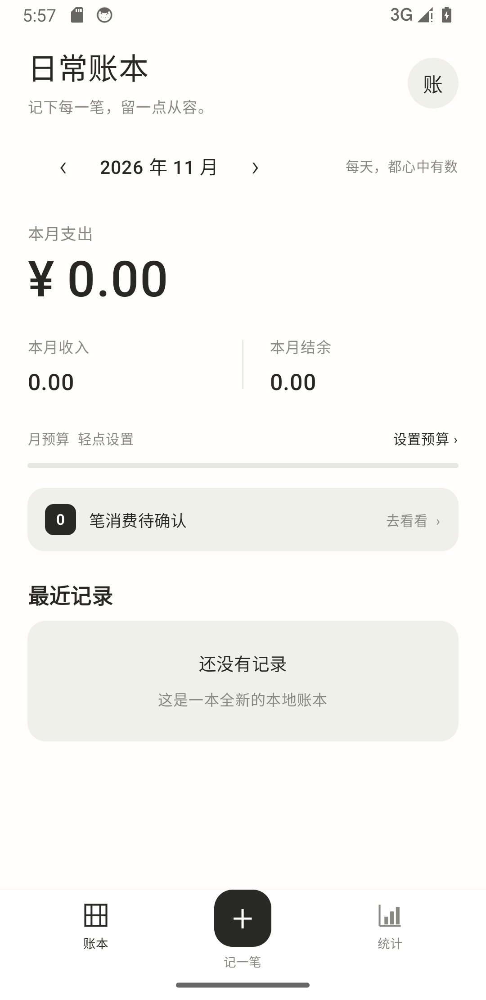
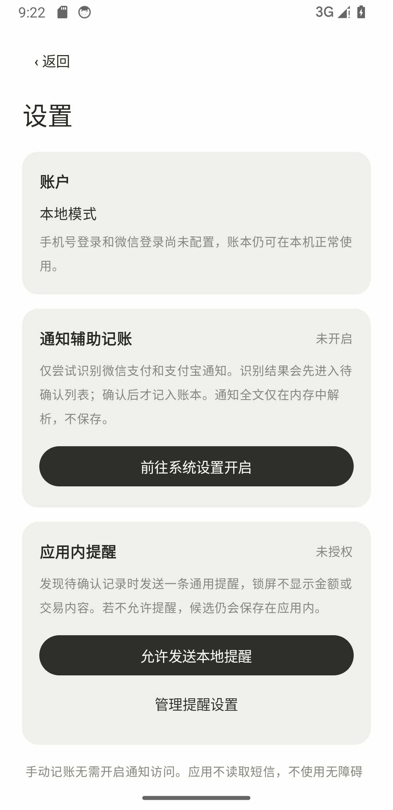

# 日常账本 · PersonalLedger

一款面向个人日常使用的原生 Android 记账应用，采用 Kotlin 和 Jetpack Compose 开发。界面以暖白、黑灰为主，突出金额、账目与简单的确认操作。

当前以本地记账和桌面「记一笔」卡片为主：点击卡片直接输入金额，再核对分类、账户并保存。手机号／微信登录和云同步需要后续接入服务；当前无需登录即可在本机使用。

开发过程、真机反馈和方案调整见 [开发日志](docs/development/开发日志.md)；最新交付与验证边界见 [当前进度](docs/development/reports/当前进度.md)。

## 功能与进度

| 能力 | 当前状态 |
| --- | --- |
| 本地账本 | SQLite持久化；首次启动为空账本 |
| 收入、支出与转账 | 金额使用整数分；转账不计入收支统计 |
| 手动记账 | 新增、编辑、删除；可选择账户、分类、日期并填写备注 |
| 桌面记账卡片 | 原生桌面小组件，约 2×1；点击直接打开记账页并聚焦金额，设置页可请求添加 |
| 月度概览 | 本月支出、收入、结余、月份切换、月预算 |
| 分类统计 | 按收入／支出查看月度分类金额 |
| 支付通知辅助记账 | 作为补充渠道；用户真机测试支付宝、微信在线付款均未产生系统通知，无法覆盖这些付款 |
| 付款页面读取验证 | 用户真机反馈基本无法读取，暂停推进；历史实验入口保留，默认不采集 |
| 手机号／微信登录 | 待接入真实认证服务与微信应用配置；当前使用本地模式 |
| 云同步 | 尚未接入 |

支付辅助记账依赖手机实际收到的可读系统通知。支持范围需要按设备与支付场景验证，不能保证覆盖微信、支付宝、淘宝、京东的每一笔支付。

通知候选不会直接计入账本。隐藏金额、多个金额或不合法格式需要人工核对；退款、转账等不按消费处理。首版按来源、通知标识与事件时间区分候选，第三方通知缺少或改变事件标识时仍可能出现重复或漏识别，请与实际支付记录核对。

候选显示的时间来自系统通知，可能与交易实际发生时间不同；确认时可以更正日期。手机没有发出可读支付通知时，需要手动记账。

## 原生界面

以下为Android14模拟器运行截图，首次启动为空账本：




## 界面设计稿

以下是已确认的设计稿，**不是原生 App 的运行截图**。

[首页、记账与统计设计稿](design/v1/images/01-core-screens.png) · [登录与支付提醒设计稿](design/v1/images/02-login-and-reminder.png)

下载仓库后，使用浏览器打开[可交互设计原型](design/v1/index.html)，或查看[设计说明](design/v1/设计说明.md)。原型中的验证码和示例数据仅用于设计演示，不会用于正式认证或注入本地账本。

## 开发环境

| 项目 | 当前配置 |
| --- | --- |
| 语言与界面 | Kotlin、Jetpack Compose、Material 3 |
| 最低 Android 版本 | Android 8.0，API 26 |
| 编译／目标 SDK | API 37 |
| JDK | 21 |
| Gradle | 9.6.0，使用项目Wrapper |
| Android Gradle Plugin | 9.5.1 |
| 本地存储 | SQLiteOpenHelper |

建议使用支持项目当前工具链的 Android Studio，并安装对应 Android SDK。SDK位置由本机的`local.properties`或开发环境提供；该文件不会提交至仓库。

## 构建与运行

克隆仓库后，在项目根目录执行：

```powershell
git clone --branch master https://github.com/Revee1106/PersonalLedger.git
cd PersonalLedger
.\gradlew.bat :app:assembleDebug
```

macOS／Linux：

```sh
./gradlew :app:assembleDebug
```

Debug安装包输出到：

```text
app/build/outputs/apk/debug/app-debug.apk
```

连接安卓设备或启动模拟器后，可在Android Studio中运行`app`，或执行：

```powershell
.\gradlew.bat :app:installDebug
```

应用包名为`com.eric.personalledger`。本地模式直接打开账本，无需先配置第三方登录。

Debug 包用于本地体验和开发验证；如需正式分发，应使用自己的签名配置构建 Release 包。签名密钥不应提交到仓库。

## 首次使用

1. 打开本地账本，点击底部“记一笔”，选择支出、收入或账户转账。
2. 输入金额，选择账户与分类，按需填写备注，再保存。
3. 在首页切换月份、设置月预算；从账目进入修改或删除，统计页查看对应月份的分类汇总。

初始账本不含演示流水，默认提供“现金”和“银行卡”账户。转账仅改变账户余额，不计入收入或支出。

## 添加桌面记账卡片

1. 打开本应用右上角「账」→ 设置 → 桌面记账卡片 → 添加到桌面，在系统弹窗中确认。
2. 若桌面不支持应用内添加，长按手机桌面空白处，从「小组件／窗口小工具」选择本应用的「记一笔 · 桌面卡片」。具体入口名称随桌面版本不同。
3. 点击卡片，直接进入记账页，金额框自动获得焦点；填写金额、收起键盘，核对分类、账户、日期后保存。卡片不展示账目或余额。

不需要通知、无障碍或悬浮窗权限，不定时读取数据或在后台刷新。如果已有未保存的新增／编辑表单，点击卡片优先返回该表单；新建表单的金额、分类、账户、日期和备注支持页面重建时恢复。冷启动时会读取账户，加载失败可在表单重试，账户未就绪不能保存。

本轮构建、19 项 JVM 测试与 12 项模拟器仪器测试通过，Lint 为 0 错误、18 警告、4 提示。已在真实模拟器桌面验证添加、进程结束后点击进入记账和保存。华为桌面仍待真机确认，步骤见 [M7 桌面记账卡片](docs/development/reports/M7_桌面记账卡片.md)。此前的独立包 `com.eric.personalledger.probe` 也包含卡片，可在保留原账本的同时体验；从独立包添加的卡片打开独立包自己的账本。

## 付款页面读取实验（暂停推进）

用户后续真机测试基本无法读取目标页面，当前不再将这条路线作为记账主线；以下为 M6 的历史实验步骤。

支付宝、微信在线付款的用户真机测试未产生系统通知，通知监听不能作为主要付款入口。下一步先验证付款页面是否暴露可读文字，不能把系统授权成功等同于支付识别可用。

1. 进入「设置 → 付款页面读取验证 → 进入验证」，阅读用途说明，前往系统开启「个人账本页面读取验证」。
2. 返回账本，确认显示「已连接」，点击「同意读取，开始五分钟验证」。
3. 切换到淘宝、京东、小红书、抖音、微信或支付宝，按自己正常使用的路径查看付款结果；也需验证购物 App 跳转钱包后返回订单页的路径。无需为了测试额外消费，可先查看已有账单详情，但旧详情可读不代表实时流程已通过。
4. 返回验证页，点击「停止读取并查看结果」。核对是否读到状态词、是否包含实际付款金额、是否出现多个金额；页面价格和成功文字不构成交易凭据。
5. 记录测试结论后点击「停止并清除结果」。无需继续验证时，可在系统关闭服务。

建议使用 `./gradlew :app:assembleProbe`（Windows 使用 `.\gradlew.bat :app:assembleProbe`）构建独立验证包，产物为 `app/build/outputs/apk/probe/app-probe.apk`。应用显示为「PersonalLedger验证」，包名 `com.eric.personalledger.probe`，可与原账本同时安装；数据和权限分别管理，无需覆盖原账本。

仅在手动启动后的五分钟内采样这六个包名的当前可见界面。原始文字只在内存短暂解析；摘要最多二十条，只包含来源、读取时间、节点数量、预设状态词和最多八个金额候选，不保存聊天、商品名、商户或订单号。密码字段及检测到密码／验证提示的页面跳过展示。服务不执行点击、滚动或支付操作，不截屏，不写入账本或待确认队列。

摘要只保存在当前进程内；五分钟到期停止采样，摘要暂留供查看，清除或进程结束后消失。普通停止后可以查看结果；再次开始会清空上一轮。服务启用不代表持续采集。当前是技术验证版，尚未确认任何目标 App 的真实页面兼容性。测试步骤和记录表见 [M6 页面读取验证](docs/development/reports/M6_页面读取验证.md)。

## 开启支付通知辅助记账（补充渠道）

1. 点击首页右上角“账”进入设置，阅读用途说明，再选择“前往系统设置开启”，为PersonalLedger开启通知访问。
2. 在“应用内提醒”中允许发送本地提醒；Android13及以上会单独请求通知权限。可以通过“管理提醒设置”调整系统通知和渠道。
3. 手机收到可识别的微信／支付宝支付通知后，App保存待确认候选并尝试发送通用提醒。点击提醒或首页“去看看”，核对金额、分类、账户、日期和备注，再确认或忽略。

通知访问与发送提醒可分别撤销。关闭发送提醒后，已识别候选仍可在App内查看；关闭通知访问后，手动记账继续可用。系统未提供通知、隐藏内容或识别不确定时，请手动核对补记。

## 测试与检查

页面读取验证版已完成 Probe 构建、19 项 JVM 测试（原有 10 项、新增 9 项）及 Lint（0 错误、15 警告、3 提示）。独立包与签名已核对；本轮未连接真机，六个目标 App 的页面可读性尚未验证。实际构建环境与记录见 [M6 页面读取验证](docs/development/reports/M6_页面读取验证.md)。以下原生 UI 与设备测试记录属于此前 M0–M5 交付。

```powershell
# 本地单元测试
.\gradlew.bat :app:testDebugUnitTest

# Android静态检查
.\gradlew.bat :app:lintDebug

# 仪器测试，需要在线设备
.\gradlew.bat :app:connectedDebugAndroidTest
```

10项JVM测试已通过；Android14模拟器上7项数据库仪器测试与1项应用上下文测试通过，覆盖金额、收支、转账、月界线、通知解析边界、持久化和通知事件重放。Lint为0 errors、18 warnings、3 hints；保留了依赖升级和代码风格等警告。界面操作验收另见[开发报告](docs/development/reports/)。

真实原生UI已验证新增12.50、编辑为15.00、关闭并重启后持久化、删除后恢复空账本，以及统计和日期操作；360dp、1.2倍字体下验证了设置页滚动及授权按钮可达，之后恢复原配置。完整过程与安装包哈希见[M4集成验收](docs/development/reports/M4_集成验收.md)。

## 数据与隐私

- 账目保存在应用私有SQLite数据库，当前不上传至服务器。
- 收入、支出与账户转账分别建模，避免转账被重复计为消费。
- 待确认消费与正式账本分开保存，只有确认后计入收支。
- 应用关闭系统账本备份，不依赖系统云备份恢复数据；当前尚无云同步，卸载应用会删除本地账本。
- 通知辅助记账需要用户明确开启通知访问，可在系统设置撤销；Android13及以上还需单独允许本App发送提醒。拒绝提醒不会阻止候选保存在App内。
- 密钥、签名文件、本地账本、`local.properties`和构建缓存不进入版本控制。

## 项目结构

```text
app/src/main/java/com/eric/personalledger/
├── accessibility/ # 手动启动的五分钟页面读取验证、内存摘要
├── data/        # 本地数据库、仓储与候选状态
├── domain/      # 金额、收支规则、通知解析
├── notifications/ # 通知来源过滤与本地系统提醒
└── ui/          # 原生Compose页面与主题
app/src/test/         # JVM业务测试
app/src/androidTest/  # Android数据库与设备测试
design/v1/            # 已确认的界面设计稿
docs/development/     # 计划、验收清单、审查和阶段报告
```

开发范围与验收标准见[开发计划](docs/development/开发计划.md)和[验收清单](docs/development/验收清单.md)。正式交付分支为`master`，源码快照、分支和安装包核对记录见[M5交付核验](docs/development/reports/M5_交付核验.md)。
